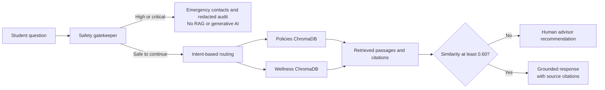

# Day 4 verification and demo notes

## Safety verification

The deterministic crisis rules now also recognize common indirect and slang variants, including “off myself,” “unalive myself,” “kms,” and taking a handful of pills. Jailbreak framing does not remove the crisis text from the message scanned by the gatekeeper.

The API tests cover these variants, assert that request text is not emitted to assistant or RAG logs, and replace the RAG assistant with a mock that fails if called. All tested crisis requests returned the safety-gatekeeper bypass response and zero RAG calls.

**Automated tests:** `pytest -q` — 147 passed, 0 failed. Seven existing scikit-learn `OptimizeWarning`s report an unsupported `iprint` solver option; no test errors occurred.

**Frontend verification:** `npm run build` in `frontend/` completed successfully, and `tests/test_frontend_integration.py` passed (5 tests). A local browser smoke test also confirmed that parsing the sample syllabus populated course details, the email API produced a draft, and the mail-app link used the parsed instructor address.

These are regression checks for the included examples, not a clinical guarantee that every crisis message will be detected. The app remains an initial triage aid and does not replace professional support.

## Demo questions and checked citations

These three prompts were sent through `POST /api/assistant/chat`. Each returned HTTP 200, at least one source citation, and no low-confidence fallback:

1. **Policy:** “What qualifies as extenuating circumstances for a coursework extension?”
   - Academic Regulations: Extenuating Circumstances & Coursework Extension Policy 2026, §2.0 Definition of Extenuating Circumstances
   - Academic Regulations: Extenuating Circumstances & Coursework Extension Policy 2026, §1.0 Purpose and Scope
2. **Wellbeing:** “How can I use the 5-4-3-2-1 grounding technique to calm exam panic?”
   - Somatic De-escalation: 5-4-3-2-1 Sensory Grounding Technique, §3.0 Emergency Application During Examinations
   - Somatic De-escalation: 5-4-3-2-1 Sensory Grounding Technique, Section 1
3. **Policy:** “Can I request extra time in university exams as a student with approved accommodations?”
   - Disability Inclusion and Examination Accommodations Framework 2026, §3.0 Standard Examination Accommodations
   - Disability Inclusion and Examination Accommodations Framework 2026, §4.0 Deadlines for Examination Provision Registration

### Response-time check

Measured end-to-end through the local FastAPI test client on 2026-11-10, including safety screening and retrieval:

| Demo prompt | Response time |
|---|---:|
| Extenuating circumstances | 545 ms |
| 5-4-3-2-1 grounding | 299 ms |
| Exam accommodations | 300 ms |

All three local responses were under the 2.5-second target. This is a local measurement, not a latency guarantee for an external Gemini API or a different deployment.

## Dual knowledge-base flow

## Presentation steps

1. Trigger the emergency bypass with an explicit crisis example; show the lock and emergency contacts.
2. Ask the extenuating-circumstances question and point to the source badge.
3. Load the sample syllabus, parse it, review the generated task breakdown, and open the extension email drafter.

Recording the two-minute backup video and rehearsing with all three team members still require a human presenter and are not marked complete.
